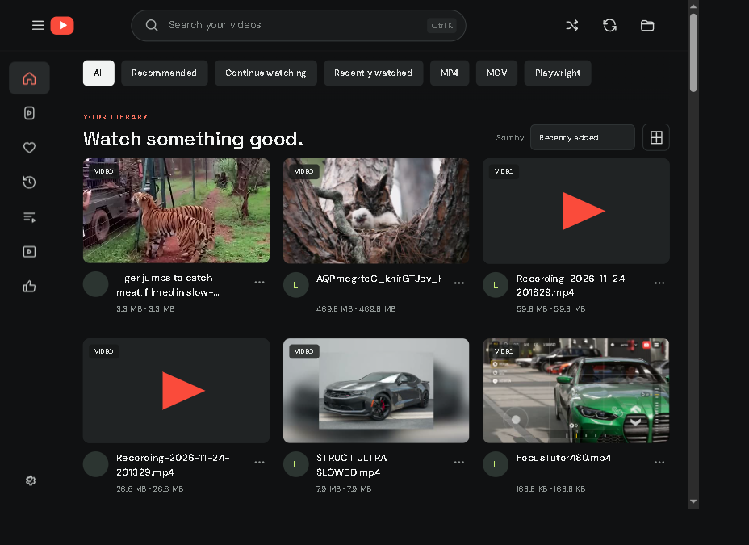
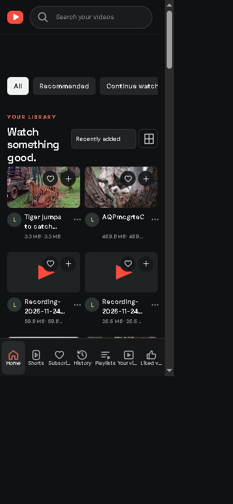

<div align="center">

# Local YouTube

**A private, desktop-ready video library for your own media.**


[Download Windows EXE](https://github.com/surjolive/local-youtube/releases/latest) · [View Screenshots](#screenshots) · [MIT License](LICENSE)

</div>

Local YouTube runs a small server on your Windows PC and streams selected local videos in a polished browser interface.

## Download

Download `Local YouTube.exe` from the [latest GitHub release](https://github.com/surjolive/local-youtube/releases/latest), then place it anywhere on Windows and double-click it.

The app:

- opens in your default browser
- runs a server on port `8000`
- shows local and Wi-Fi addresses
- hides the terminal and request logs
- creates thumbnails and compatible copies for supported media

## Addresses

- Local: `http://localhost:8000`
- Wi-Fi/LAN: `http://YOUR-PC-IP:8000`

Keep the PC and connected device on the same Wi-Fi network. Windows Firewall may ask you to allow access on private networks.

## Screenshots

### Desktop



### Mobile



The Windows launcher opens automatically in the browser and shows the local address and available Wi-Fi/LAN addresses without a terminal window.

## Features

- Home, Shorts, History, Favorites, Playlists, Liked videos, and Library views
- Search, categories, and sorting
- Custom video and audio player controls
- Resume playback and local watch history
- Browser IndexedDB storage for playlists and library preferences
- MP4, MOV, MP3, and server-discovered media support
- Desktop, tablet, and mobile layouts

## Run from source

```powershell
python -m pip install pillow pyinstaller
python server.py
```

Open `http://localhost:8000`.

For the windowed desktop launcher:

```powershell
python launcher.pyw
```

## Build the Windows executable

```powershell
python -m PyInstaller --noconsole --onefile --name "Local YouTube" --icon "local-youtube.ico" --add-data "index.html;." --add-data "favicon.svg;." --add-data "css;css" --add-data "js;js" --collect-submodules server launcher.pyw
```

The packaged app is written to `dist/Local YouTube.exe`.

## Privacy

Media stays on the local PC or selected browser storage. The app does not upload videos or require an account. LAN access is restricted to devices that can reach the Windows PC; do not expose port `8000` to the public internet.

## Keyboard shortcuts

- `Space`: Play/pause
- `Left` / `Right`: Seek 5 seconds
- `Up` / `Down`: Change volume
- `F`: Fullscreen
- `T`: Theater mode
- `M`: Mute
- `Ctrl+K`: Focus search

## License

MIT License. See [LICENSE](LICENSE).
